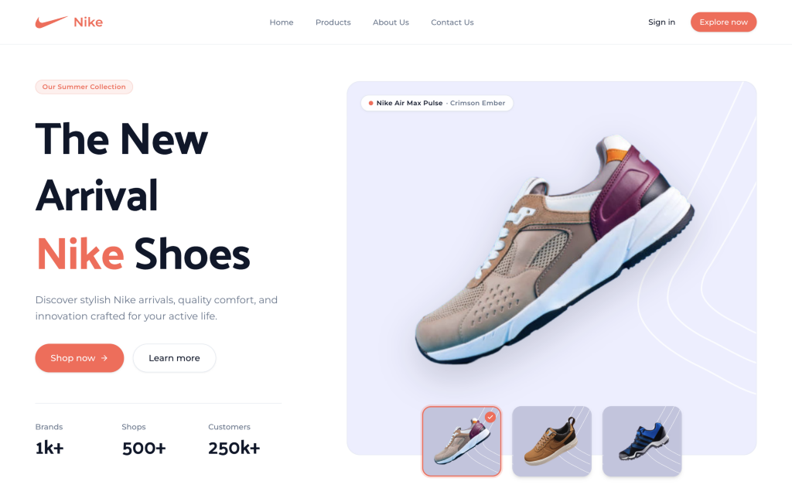

<div align="center">

# Nike Storefront

**Modern Nike footwear storefront rebuilt with Astro 7, Tailwind CSS v4, Base UI (`devl.dev` / `shadcn` registry), MVVM architecture, and SOLID principles.**

[](https://astro.build)
[](https://tailwindcss.com)
[](https://base-ui.com)
[](https://www.typescriptlang.org)
[](https://nodejs.org)

[Live Demo](https://nike-storefronts.vercel.app/) · [Architecture](#architecture-mvvm--solid) · [Getting Started](#getting-started)

</div>

---



## Highlights

- **Astro 7 Islands Architecture** — Static sections compile to pure HTML with **0 KB** client JavaScript, while interactive islands hydrate selectively (`client:load` & `client:visible`).
- **Base UI + Tailwind CSS v4 (`devl.dev` / `coss ui`)** — Accessible headless primitives (`Button`, `Input`, `Sheet`, `Separator`) paired with `@theme inline` semantic design tokens and `cva` variants.
- **5-Directory MVVM + SOLID Standard** — Strictly separates immutable domain contracts (`models`), framework-agnostic reactive state (`viewmodels`), and thin presentational UI (`views`).
- **Web Performance & Accessibility** — `fetchPriority="high"` on the Hero LCP sneaker image, `loading="lazy"` on below-the-fold media, radio-backed choice cards with zero layout shift, and `:user-invalid` post-interaction form validation with synced ARIA states.

## Tech Stack

| Layer | Technology |
| --- | --- |
| Framework | [Astro 7](https://astro.build) + `@astrojs/react` |
| Styling | [Tailwind CSS v4](https://tailwindcss.com) (`@tailwindcss/vite`) |
| UI Primitives | [Base UI](https://base-ui.com) (`@base-ui/react`), [devl.dev](https://devl.dev/components) / `shadcn` registry, `class-variance-authority`, `lucide-react` |
| State Management | [Nano Stores](https://github.com/nanostores/nanostores) (`nanostores` + `@nanostores/react`) |
| Language & Runtime | TypeScript (strict) · Node.js `>=24.0.0` |
| Deployment | [Vercel](https://vercel.com) (`vercel.json`) |

## Architecture (MVVM + SOLID)

```text
src/
├── models/             # Immutable domain interfaces (*.model.ts) & concrete datasets/services (*.data.ts)
├── viewmodels/         # ViewModel classes, factories, & Nano Stores island ViewModels (*.viewmodel.ts)
├── views/
│   ├── layouts/        # Base HTML document shell & SEO metadata
│   ├── components/     # Base UI + Tailwind v4 primitives (ui/), Astro cards, & interactive React islands
│   └── sections/       # Static page sections composed in Astro
├── styles/             # Tailwind CSS v4 @theme design tokens & accessibility utilities (index.css)
└── pages/              # Thin composition root wiring ViewModels to Views
```

### SOLID Enforcement

- **Single Responsibility (SRP):** Domain models, concrete data, reactive ViewModels, UI primitives, and Astro views each own one focused responsibility.
- **Open/Closed (OCP):** UI primitives (`Button`, `Badge`) extend via `cva` variants without modifying internals; `StorefrontViewModel` accepts any `IStorefrontModel` implementation.
- **Liskov Substitution (LSP):** Any model or newsletter service adhering to `IStorefrontModel` / `INewsletterService` is seamlessly substitutable.
- **Interface Segregation (ISP):** `StorefrontViewModel` exposes narrow typed getter slices (`meta`, `navbar`, `hero`, `popularProducts`, `services`, `customerReviews`, `footer`) so each section receives only what it consumes.
- **Dependency Inversion (DIP):** ViewModels depend on `IStorefrontModel` and `INewsletterService` abstractions injected via constructor/factory arguments.

## Astro Hydration & Performance Strategy

| Directive / Pattern | Where Used | Purpose |
| --- | --- | --- |
| `client:load` | `NavbarIsland`, `HeroShowcaseIsland` | Hydrates immediately on page load for above-the-fold interactive controls (mobile navigation drawer & hero sneaker switcher). |
| `client:visible` | `SubscribeFormIsland` | Defers downloading and hydrating React JS until the newsletter section enters the viewport (`IntersectionObserver`), keeping initial JS minimal. |
| Static `.astro` Views | `PopularProducts`, `SuperQuality`, `Services`, `SpecialOffers`, `CustomerReviews`, `Footer` | Rendered to pure HTML at build time with **0 KB** client JavaScript. |
| `fetchPriority="high"` | Hero LCP sneaker image | Boosts network priority for the Largest Contentful Paint image (without `loading="lazy"`). |
| `loading="lazy"` | Below-the-fold product, offer, review, & footer images | Defers off-screen image requests until scrolled near the viewport. |

## Getting Started

### Prerequisites

- **Node.js** `>=24.0.0` (or [Bun](https://bun.sh))

### Local Development

```bash
bun install
bun run dev
```

### Type Check & Production Build

```bash
npx tsc --noEmit && bun run build
bun run preview
```

### Adding Registry Components (`devl.dev` / `coss ui`)

`components.json` is pre-configured with `@devl` and `@coss` registries:

```bash
npx shadcn@latest add @devl/<component-slug>
```

## License

MIT
